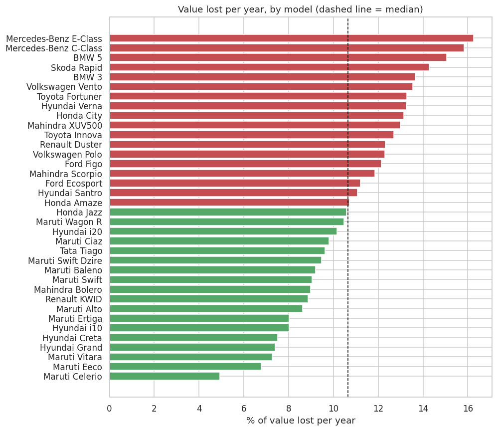
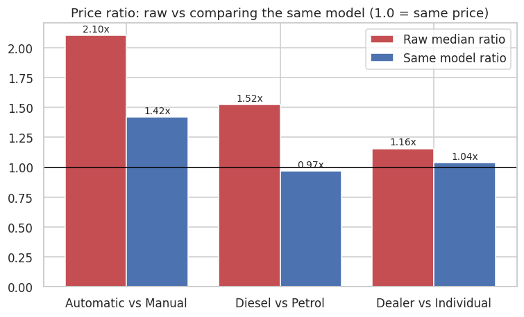
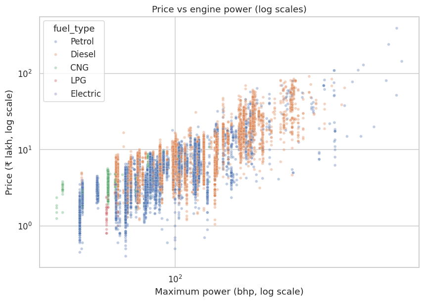
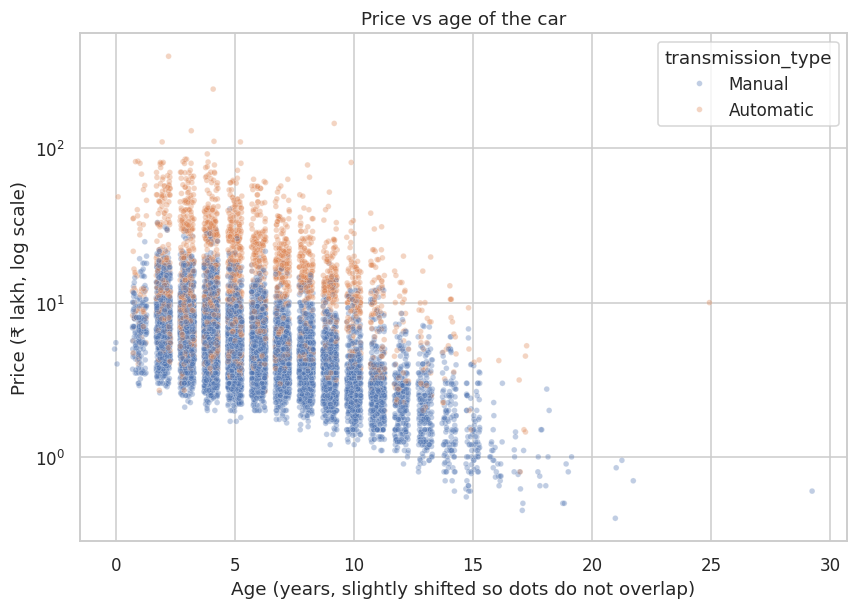
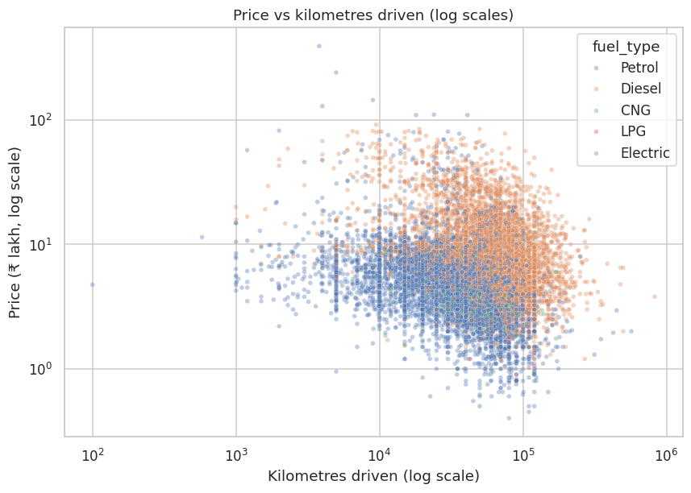
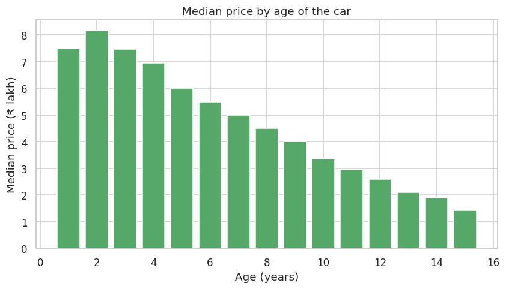
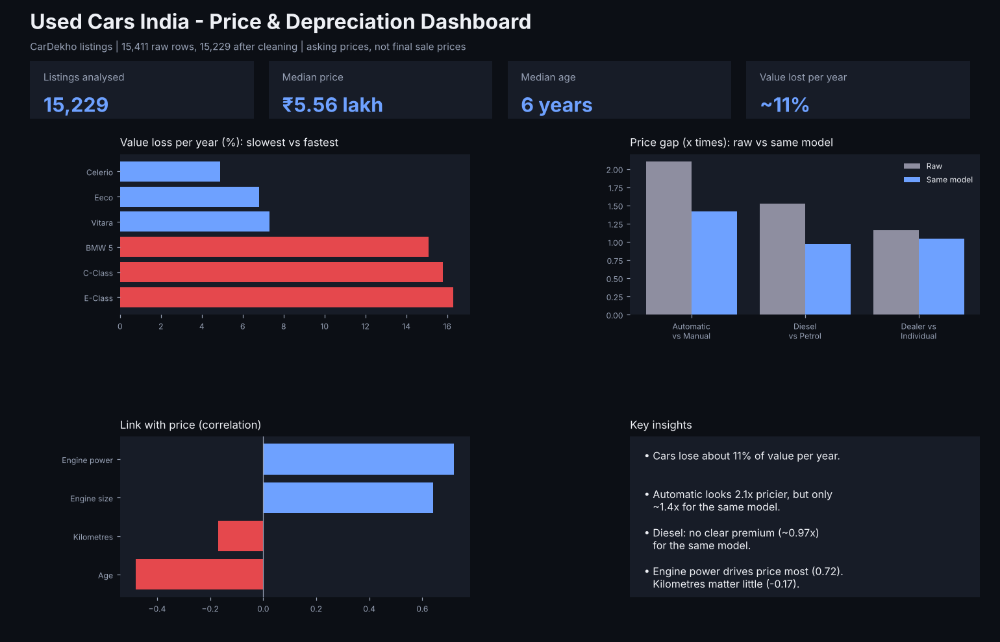

# Used Car Price Analysis (India)

I analysed 15,229 used car listings from India to find out how fast cars lose value, what drives the price, and whether automatic, diesel and dealer cars really cost more or only look that way because they are different cars. I used Python and SQL.

**Tools:** Python (Pandas, NumPy, SciPy), SQL (SQLite), Matplotlib, Seaborn, Plotly

## Dataset
See `DATA.md` for how to get the raw file and `check_raw_data.py` to check you have the right one.

- CarDekho used car listings, downloaded from Kaggle (file `cardekho_dataset.csv`).
- 15,411 rows and 14 columns: brand, model, age, kilometres driven, seller type, fuel, transmission, mileage, engine size, power, seats and selling price in rupees.
- The raw file is not in this repo. Download it from Kaggle and save it as `cardekho_dataset.csv` next to the notebook. The cleaned data is in `outputs/cars_cleaned.csv`.

## Questions I tried to answer
1. How fast do used cars lose value?
2. What matters most for the price: age, kilometres, engine power or something else?
3. Are automatic, diesel and dealer cars really more expensive, or are they just different cars?
4. Which models hold their value best?

## What I did
1. **Checked data quality with SQL:** duplicates, impossible values, brand spellings, labels that look wrong.
2. **Cleaned the data** and logged every step. 15,229 of 15,411 rows (99%) were kept.
3. **Answered business questions with SQL** (medians with `ROW_NUMBER`, `LAG`, `FIRST_VALUE`, `NTILE`, `RANK`, CTEs, self joins).
4. **Measured value loss per model in Python** by fitting a line to log(price) against age for each model.
5. **Compared groups fairly** (automatic vs manual, diesel vs petrol, dealer vs individual) by comparing within the same model. In SQL I also use median prices (not averages) for this, so the SQL and the Python give the same answer: about 1.42x for automatic vs manual across 16 models.
6. **Made charts** including four scatter plots with log scales, and an interactive Plotly chart.

### Cleaning decisions
| Step | Rows affected |
|---|---|
| Old row number column dropped | all rows |
| Brand spelling made consistent (ISUZU and Isuzu) | 2 |
| Exact duplicate rows removed | 167 |
| Cars with 0 seats removed | 2 |
| Cars driven more than 100,000 km per year removed (for example 3.8 million km on a 5 year old car) | 13 |

Other decisions:
- Cars over ₹1 crore (7 cars, such as Ferrari and Rolls-Royce) are real, so I kept them. I use medians and log scales so they do not distort the results.
- 4 rows are labelled Electric but all are the Toyota Camry with a petrol-type engine size, so the label is probably wrong. I kept them but left them out of fuel comparisons.
- CNG and LPG mileage is in a different unit (km per kg), so mileage analysis uses petrol and diesel only.

## Key findings
- **The market:** the median car is 6 years old, has 50,000 km on it and costs ₹5.6 lakh. Maruti and Hyundai are 52% of all listings.
- **Value loss:** comparing the same model at different ages, cars lose about **11% of their value per year** (median across 36 models).
- **It depends on the model.** Slowest: Maruti Celerio (4.9%), Maruti Eeco (6.8%), Maruti Vitara (7.3%). Fastest: Mercedes-Benz E-Class (16.3%), Mercedes-Benz C-Class (15.8%), BMW 5 (15.1%).
- **What drives price:** engine power has the strongest link with price (correlation 0.72). Age is next (-0.48). Kilometres driven matter much less (-0.17).
- **Automatic vs manual:** the raw median gap is 2.1x, but for the same model it is about 1.42x (16 models compared). Most of the raw gap is because automatic cars are bigger, pricier models.
- **Diesel vs petrol:** raw gap 1.52x, but about 0.97x for the same model (16 models). I see no clear diesel premium once the model is the same.
- **Dealer vs individual:** raw gap 1.16x, about 1.04x for the same model (29 models).
- **Bigger engines use more fuel:** correlation between engine size and mileage is -0.49 (petrol and diesel).

## Charts

More charts are in the `charts` folder. The `.html` file is an interactive Plotly chart: download it and open it in a browser.

## Limits of this analysis
- These are asking prices from listings, not final sale prices.
- The data has no city, condition, accident history or variant (base or top model), and these affect the price a lot.
- The same-model comparison does not control for age and kilometres. It is a closer comparison, not proof that transmission or fuel causes the price difference.
- Removing exact duplicates assumes they are the same listing added twice.
- Value loss per year is an average over the ages in the data. Real cars may lose value faster in the first years.

## Files
- `used_car_price_analysis.ipynb`: full analysis with all outputs
- `analysis.sql`: all SQL queries
- `charts/`: chart images and one interactive chart
- `outputs/cars_cleaned.csv`: cleaned data
- `outputs/value_loss_by_model.csv`, `outputs/raw_vs_same_model_gap.csv`, `outputs/cleaning_log.csv`: result tables

## How to run
1. Download the dataset from Kaggle and save it as `cardekho_dataset.csv` in the same folder as the notebook.
2. `pip install -r requirements.txt`
3. Open `used_car_price_analysis.ipynb` in Jupyter or Google Colab and run all cells.

## Dashboard

